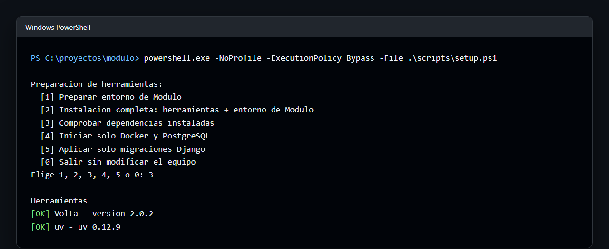
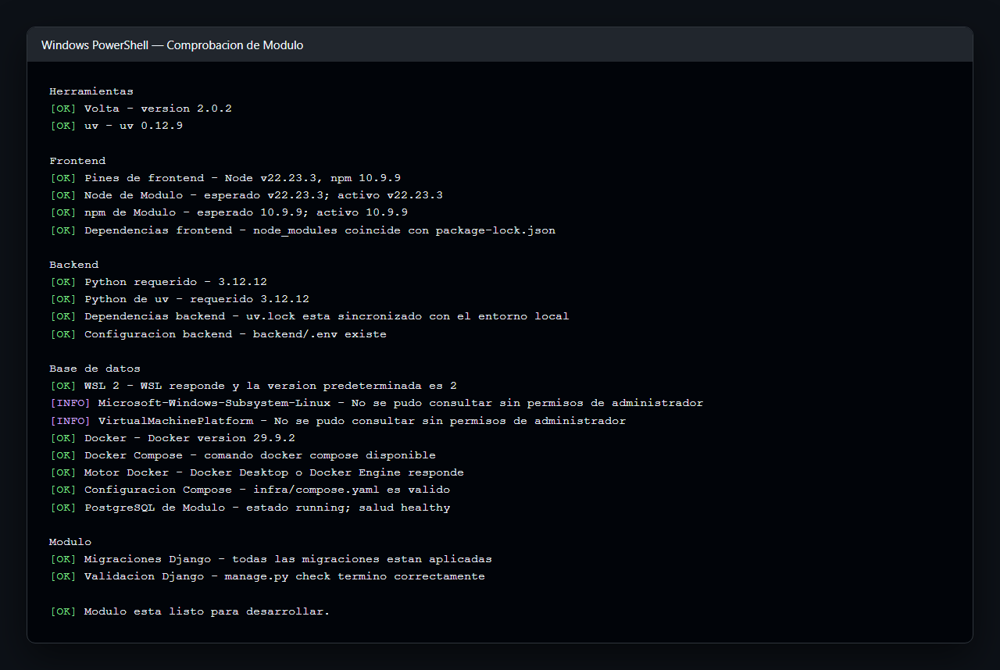

# Instalación de herramientas

Esta guía prepara las tres herramientas que usa Modulo: [uv](https://docs.astral.sh/uv/) para Python, [Volta](https://docs.volta.sh/) para Node.js y npm, y [Docker Compose](https://docs.docker.com/compose/) para PostgreSQL. En Windows, el script del repositorio instala las que falten y prepara el clon; las instrucciones manuales permanecen aquí para otros sistemas y casos de diagnóstico.

No instales Python, Node.js, npm ni PostgreSQL manualmente solo para Modulo. Si ya los tienes para otros proyectos, pueden coexistir: esta guía prioriza los gestores del proyecto y no pide desinstalar nada salvo que haya un conflicto real de `PATH` o de puertos.

## Windows: metodo recomendado

Después de clonar el repositorio, ejecuta desde su raíz:

```powershell
powershell.exe -NoProfile -ExecutionPolicy Bypass -File .\scripts\setup.ps1
```

El comando funciona tanto en Windows PowerShell 5.1 como en PowerShell 7. Si tu política de ejecución ya permite scripts locales, también sirve `.\scripts\setup.ps1`.

Elige `[1]` para preparar un clon con las herramientas ya instaladas. Elige `[2]` para una **instalación completa: herramientas + entorno de Modulo**; instala lo que falte con WinGet, configura Volta/uv y prepara el clon. Elige `[3]` para revisar el estado sin modificar nada. Elige `[4]` para preparar la infraestructura: si no encuentra un cliente Docker con Compose, ofrece instalar Docker Desktop con WinGet y luego inicia Docker y PostgreSQL; al terminar, pregunta si también debe aplicar migraciones. Elige `[5]` para iniciar PostgreSQL si hace falta y aplicar solo las migraciones Django. La sección [Preparador de Windows](#preparador-de-windows-scriptssetupps1) detalla cada opción.

La instalación inicial de Docker Desktop puede pedir que aceptes sus términos o completes WSL 2/virtualización. Ábrelo y termina esa configuración antes de volver a ejecutar el script. En macOS, Linux y Windows con una preparación manual preferida, sigue las secciones específicas de esta guía y la ruta manual del [README principal](../README.md).

### Capturas del preparador

El menú muestra las acciones disponibles:



Este informe de `[3]` muestra un entorno listo para desarrollar. Las opciones de estado de Windows pueden aparecer como informativas cuando PowerShell no está elevado.



Después de completar `[1]`, el resultado esperado termina con `[OK] Modulo esta listo para desarrollar.`. Cada sección del informe debe estar en `[OK]`; los datos de runtime deben coincidir con los archivos declarativos del proyecto. Algunas líneas `[INFO]` de características de Windows pueden permanecer cuando PowerShell no está elevado, aunque Docker y Modulo estén listos.

## Comprobar antes de instalar

Ejecuta lo siguiente en una terminal nueva:

```bash
uv --version
volta --version
docker --version
docker compose version
docker info
```

Los cuatro primeros comandos confirman que los clientes están disponibles. `docker info` también confirma que el motor está iniciado. En Windows y macOS, abre Docker Desktop si el comando indica que no puede conectar al daemon.

Para revisar actualizaciones, consulta primero la documentación de cada herramienta: [actualizar uv](https://docs.astral.sh/uv/getting-started/installation/#upgrading-uv), [actualizar Volta](https://docs.volta.sh/guide/getting-started) y [actualizar Docker Desktop](https://docs.docker.com/desktop/setup/install/upgrade/). Mantén las herramientas actualizadas con un método coherente con el que usaste para instalarlas (por ejemplo, WinGet, Homebrew o el instalador oficial). No hace falta actualizar una versión de runtime global para este repositorio: uv y Volta leerán sus declaraciones locales.

## uv y Python

uv instala y selecciona el Python que necesita cada proyecto. En Modulo, `backend/.python-version` indica el intérprete; `backend/pyproject.toml` define el rango compatible; y `backend/uv.lock` fija las dependencias. Desde `backend/`, `uv python install` instala la versión declarada si no existe y `uv sync --frozen` crea o actualiza `.venv` respetando el lockfile.

Comprueba qué se usará sin depender de tu Python global:

```bash
cd backend
uv python find
uv run --frozen python --version
uv tree --frozen
```

### Instalar uv

Sigue siempre las [instrucciones oficiales de uv](https://docs.astral.sh/uv/getting-started/installation/). Opciones habituales:

- Windows: `winget install --id astral-sh.uv -e` o el instalador oficial de uv.
- macOS: `brew install uv` si ya usas Homebrew, o el instalador oficial.
- Linux: el instalador oficial o el gestor de paquetes indicado por la documentación de uv.

Cierra y abre la terminal después de instalar. En Windows, `Get-Command uv` muestra el ejecutable que se resolverá; en macOS/Linux usa `command -v uv`.

### Python ya instalado o gestionado por otra herramienta

Puedes conservar Python del sistema, pyenv, conda, asdf o cualquier otro gestor. uv no los elimina y puede encontrarlos, pero Modulo se prepara de forma más reproducible dejando que uv instale la versión indicada por `.python-version`. Evita crear un entorno virtual manual o ejecutar `pip install` dentro de `backend/`: usa `uv sync --frozen` y `uv run`.

Si una política de tu equipo exige un Python concreto, comprueba `uv python find` y consulta [la resolución de intérpretes de uv](https://docs.astral.sh/uv/concepts/python-versions/). Si el resultado no corresponde a la declaración del repositorio, no edites el lockfile para corregirlo: instala el intérprete con `uv python install` y vuelve a sincronizar.

## Volta, Node.js y npm

Volta es el gestor de Node.js y npm para Modulo. `frontend/package.json` contiene los pines de Volta y npm; `frontend/package-lock.json` fija el árbol de dependencias. Ejecuta los comandos npm desde `frontend/`, donde Volta detecta esos pines.

```bash
cd frontend
volta list
node --version
npm --version
npm ci
```

`npm ci` usa el lockfile tal como está versionado; no sustituyas este comando por `npm install` durante la preparación inicial.

### Instalar Volta

Usa la [guía oficial de instalación de Volta](https://docs.volta.sh/guide/getting-started). En Windows también puedes usar:

```powershell
winget install --id Volta.Volta -e
```

En macOS y Linux, usa el instalador mostrado por la documentación oficial. Abre una terminal nueva y confirma `volta --version` antes de continuar. Al entrar en `frontend/`, la primera ejecución de `node` o `npm` puede descargar los runtimes declarados por el proyecto.

### Node.js, npm, nvm o fnm ya instalados

No desinstales Node.js, nvm, fnm, asdf o una instalación corporativa solo por usar Modulo. El requisito es que los shims de Volta tengan prioridad al trabajar en este repositorio. Comprueba `volta which node` y `volta which npm`; después confirma que `node --version` y `npm --version`, ejecutados desde `frontend/`, coinciden con el bloque `volta` y `packageManager` de `frontend/package.json`.

Si no coinciden, revisa el orden de `PATH` y la inicialización de nvm/fnm en tu shell. No mezcles gestores en la misma sesión: abre una terminal limpia, activa Volta según su instalación y vuelve a ejecutar las comprobaciones. Los paquetes globales de npm tampoco forman parte de la preparación de Modulo; las herramientas del proyecto se instalan con `npm ci`.

## Docker y Docker Compose

La configuración de desarrollo está en `infra/compose.yaml`. Compose inicia únicamente PostgreSQL en un volumen Docker llamado por el proyecto y lo publica por defecto en `127.0.0.1:5432`. Django y Angular se ejecutan en el host.

### Instalar Docker

- Windows: instala [Docker Desktop para Windows](https://docs.docker.com/desktop/setup/install/windows-install/). Requiere la virtualización compatible indicada por Docker; completa la configuración inicial de Docker Desktop.
- macOS: instala [Docker Desktop para Mac](https://docs.docker.com/desktop/setup/install/mac-install/).
- Linux: instala [Docker Engine](https://docs.docker.com/engine/install/) para tu distribución y el [plugin de Docker Compose](https://docs.docker.com/compose/install/linux/). Docker Desktop para Linux es una alternativa si tu equipo lo prefiere.

Las versiones actuales de Docker Desktop y el plugin incluyen Compose como `docker compose`. No instales el binario heredado `docker-compose` si `docker compose version` ya funciona. Si ya tienes Docker Engine o Docker Desktop, consérvalo y verifica que el daemon esté encendido con `docker info`.

### Preparador de Windows (`scripts/setup.ps1`)

El script es el metodo principal para preparar Modulo en Windows. Tras clonar, ejecútalo desde la raíz:

```powershell
powershell.exe -NoProfile -ExecutionPolicy Bypass -File .\scripts\setup.ps1
```

Al iniciarse, el script muestra estas opciones en la terminal. Las opciones `1`, `2` y `4` piden confirmar con `[Y/n]` (`Y` confirma; `N` cancela); `3` comprueba directamente:

- `1`: prepara el backend y frontend con las herramientas instaladas. Después pregunta si debe iniciar Docker, PostgreSQL y aplicar migraciones.
- `2`: **instalación completa: herramientas + entorno de Modulo**. Instala solo los prerrequisitos que falten, configura Volta/uv para el usuario actual y prepara Modulo. Confirma antes de continuar.
- `3`: comprueba dependencias instaladas y el estado de Modulo. En Windows tambien revisa `wsl --status` y el estado de las caracteristicas `Microsoft-Windows-Subsystem-Linux` y `VirtualMachinePlatform`, ademas del motor Docker. La consulta de caracteristicas puede requerir PowerShell como administrador; si no se puede consultar, lo indica sin elevar permisos. Tambien revisa Volta, Node/npm fijados por el proyecto, uv, Python, los entornos y lockfiles, `backend/.env`, Compose, PostgreSQL, migraciones y la validacion de Django. Muestra `OK`, `NO` o `INFO` con el motivo y una solucion sugerida, sin confirmar ni cambiar archivos.
- `4`: prepara la infraestructura. Si no encuentra un cliente Docker, ofrece instalar Docker Desktop con WinGet; después inicia Docker Desktop o Docker Engine si es necesario y levanta PostgreSQL mediante Compose. Cuando PostgreSQL está listo, pregunta si también debe aplicar las migraciones; la respuesta predeterminada es `N`.
- `5`: inicia Docker y PostgreSQL si hace falta, y aplica las migraciones Django con el entorno backend existente. No sincroniza dependencias ni toca el frontend.
- `0`: sale sin preparar el proyecto ni modificar el equipo.

Es seguro ejecutarlo de nuevo en el mismo clon o en otro clon: reutiliza las herramientas y las cachés existentes, no actualiza herramientas ya presentes, no sobrescribe `backend/.env`, no modifica los lockfiles y aplica solamente las migraciones pendientes.

En las opciones `1` y `2`:

1. Crea `backend/.env` copiando `.env.example` solo si todavía no existe, lee `backend/.python-version`, instala esa versión con uv y ejecuta `uv sync --frozen`.
2. Lee los pines `volta` de `frontend/package.json`, ejecuta `volta fetch` para descargar Node.js/npm en la caché de Volta, valida las versiones activas y ejecuta `npm ci --no-audit --no-fund`.
3. Comprueba Docker y `docker compose`, inicia el motor si es necesario, levanta PostgreSQL con `docker compose -f infra/compose.yaml up -d --wait`, aplica migraciones y ejecuta `manage.py check`. La opción `1` pregunta antes de este paso; la `2` continúa automáticamente.

`-InstallPrerequisites` evita el menu y selecciona la instalacion de herramientas faltantes, aunque conserva la confirmacion:

```powershell
powershell.exe -NoProfile -ExecutionPolicy Bypass -File .\scripts\setup.ps1 -InstallPrerequisites
```

Antes de preparar el proyecto, el script comprueba si faltan Volta, uv o un cliente Docker. Docker se considera disponible tanto si procede de Docker Desktop instalado por `.exe`/`.msi` como de otro Docker Engine que suministre `docker` y Compose; no depende de una única ruta del ejecutable de Docker Desktop. Para cada herramienta ausente usa WinGet con estos identificadores: `Volta.Volta`, `astral-sh.uv` y `Docker.DockerDesktop`. No actualiza ni desinstala una herramienta que ya esté presente. También añade al proceso actual las rutas conocidas de las herramientas recién instaladas, por lo que continúa automáticamente con uv, Volta y Compose cuando estén disponibles.

El script busca el ejecutable real de WinGet incluido con Microsoft App Installer en lugar de invocar directamente el alias de `WindowsApps`. Si al escribir `winget` se abre el diálogo de «Selecciona una aplicación», instala o actualiza **Microsoft App Installer** desde Microsoft Store y vuelve a ejecutar el script; el preparador mostrará ese diagnóstico en vez de intentar continuar con un alias roto.

La opción `2` y `-InstallPrerequisites` configuran el usuario actual: colocan los shims de Volta (`%LOCALAPPDATA%\Volta\bin`) al principio del `PATH` de usuario y guardan `UV_MANAGED_PYTHON=true`. En terminales nuevas, Volta tendrá prioridad sobre un Node.js independiente, nvm o fnm; fuera de un proyecto con pines, usará el Node predeterminado de Volta. Los runtimes anteriores no se eliminan, pero pueden quedar ocultos por ese orden de `PATH`. Si otros proyectos dependen de nvm/fnm o de otro Node, elige `1` o usa `-SkipPrerequisiteInstallation` después de haber comprobado que Volta, uv y Docker ya están disponibles.

Después de preparar backend y frontend, la opción `[1]` pregunta si quieres continuar con Docker, PostgreSQL y las migraciones; responder `N` termina correctamente con esas tres tareas pendientes. La opción `[2]` continúa automáticamente. Si el motor Docker no responde, el script localiza Docker Desktop tanto en las rutas habituales como junto al cliente `docker.exe`, lo inicia y espera hasta 90 segundos. Si no puede localizarlo, abrirlo o el motor no queda listo, muestra un aviso explícito para abrir Docker Desktop manualmente y completar sus términos, WSL 2, virtualización o un reinicio.

Si las herramientas ya están instaladas y necesitas preparar el clon sin instalar nada ni modificar el `PATH` o las variables de entorno del usuario, usa:

```powershell
powershell.exe -NoProfile -ExecutionPolicy Bypass -File .\scripts\setup.ps1 -SkipPrerequisiteInstallation
```

Para comprobar qué quedó configurado:

```powershell
Get-Command volta, uv, node, npm, docker
volta which node
volta which npm
[Environment]::GetEnvironmentVariable('UV_MANAGED_PYTHON', 'User')
[Environment]::GetEnvironmentVariable('Path', 'User') -split ';' | Select-Object -First 5
```

El script no modifica `package.json`, `package-lock.json`, `pyproject.toml`, `uv.lock` ni `infra/compose.yaml`; tampoco sobrescribe `.env` ni borra volúmenes Docker. Para dejar de preferir uv administrado, elimina `UV_MANAGED_PYTHON` de las variables de entorno del usuario. Para dejar de priorizar Volta, quita `%LOCALAPPDATA%\Volta\bin` del `PATH` de usuario desde la configuración de Windows; no es necesario desinstalar Volta.

### PostgreSQL existente y conflictos de puerto

No hace falta instalar PostgreSQL en el host. Una instalación o contenedor existente puede seguir funcionando; el único conflicto habitual es el puerto publicado. Antes de levantar Modulo, inspecciona el estado:

```bash
docker compose -f infra/compose.yaml ps
docker ps --format "table {{.Names}}\t{{.Ports}}"
```

En Windows también puedes identificar quién usa el puerto con:

```powershell
Get-NetTCPConnection -LocalPort 5432 -ErrorAction SilentlyContinue
```

Si `5432` ya está ocupado, elige un puerto libre, por ejemplo `5433`, y cambia **ambos** valores locales: el lado izquierdo de `ports` en `infra/compose.yaml` a `127.0.0.1:5433:5432` y `POSTGRES_PORT=5433` en `backend/.env`. No detengas ni borres el contenedor o la base de otro proyecto para liberar el puerto.

Para iniciar la base de datos de Modulo:

```bash
docker compose -f infra/compose.yaml up -d --wait
docker compose -f infra/compose.yaml ps
```

El volumen persiste al ejecutar `docker compose ... down`. No uses `down -v` salvo que quieras eliminar deliberadamente la base de datos local de Modulo.

## Preparar Modulo después de las herramientas

Vuelve al [README principal](../README.md) y sigue «Clonar y preparar». El script `scripts/setup.ps1` automatiza esa secuencia en Windows: crea `backend/.env` solo si falta, sincroniza dependencias bloqueadas, inicia PostgreSQL y aplica migraciones. No sobrescribe un `.env` existente ni modifica las declaraciones de versiones o los lockfiles.
