# Mapa del scaffolding frontend

Este mapa resume la organización actual de `frontend/src/app/`. Las áreas de negocio viven en `features/`; las piezas transversales están en `core/`, `layout/` y `shared/`.

```mermaid
flowchart TB
  APP["app/"] --> CORE["core/"]
  APP --> FEATURES["features/"]
  APP --> LAYOUT["layout/"]
  APP --> SHARED["shared/"]

  CORE --> API["api/\ncliente HTTP"]
  CORE --> AUTH["auth/\nsesión · roles · guards"]
  CORE --> CONFIG["config/\nfeature flags"]
  CORE --> DEV["dev-tools/\nswitcher · salud de APIs"]
  CORE --> MODELS["models/\nmodelos transversales"]

  LAYOUT --> APP_SHELL["app-shell/\nportal interno"]
  LAYOUT --> PUBLIC_SHELL["public-shell/\ncatálogo opcional"]
  LAYOUT --> NAV["main-navigation/"]

  FEATURES --> AUTH_F["auth/\nlogin"]
  FEATURES --> DASH["dashboard/\nresumen operativo"]
  FEATURES --> CONTACTS["contacts/\nlista · detalle · alta · edición"]
  FEATURES --> PROPS["properties/\nlista · detalle · alta · edición"]
  FEATURES --> APPTS["appointments/\nlista · detalle · alta · edición"]
  FEATURES --> CLOSINGS["closings/\nlista · detalle · alta · edición"]
  FEATURES --> AGENTS["agents/\ndirectorio"]
  FEATURES --> USERS["users/\nusuarios"]
  FEATURES --> SETTINGS["settings/\nconfiguración"]
  FEATURES --> CATALOG["catalog/\npúblico opcional"]
  FEATURES --> SYSTEM["system/\n403 · 404 · offline"]

  CONTACTS --> CONTACT_PAGES["pages/"]
  PROPS --> PROP_PAGES["pages/"]
  APPTS --> APPT_PAGES["pages/"]
  CLOSINGS --> CLOSING_PAGES["pages/"]

  CONTACTS --> CONTACT_DATA["data-access/\nAPI + estado local de preview"]
  PROPS --> PROP_DATA["data-access/\nAPI tipada"]
  APPTS --> APPT_DATA["data-access/\nAPI tipada"]
```



## Convención por feature

```text
features/<area>/
├── <area>.routes.ts
├── data-access/       # servicios HTTP y estado específico del área
├── models/            # tipos e interfaces del dominio
└── pages/
    └── <page-name>/
        ├── <page>.component.ts
        ├── <page>.component.html
        └── <page>.component.scss
```

## Mapa rápido de páginas

| Área | Rutas preparadas |
| --- | --- |
| Acceso | `/login` |
| Dashboard | `/app/dashboard` |
| Contactos | `/app/contactos`, `/app/contactos/nuevo`, `/app/contactos/:id`, `/app/contactos/:id/editar` |
| Propiedades | `/app/propiedades`, `/app/propiedades/nueva`, `/app/propiedades/:id`, `/app/propiedades/:id/editar` |
| Citas | `/app/citas`, `/app/citas/nueva`, `/app/citas/:id`, `/app/citas/:id/editar` |
| Cierres | `/app/cierres`, `/app/cierres/nuevo`, `/app/cierres/:id`, `/app/cierres/:id/editar` |
| Público opcional | `/`, `/propiedades/:id`, `/privacidad` |
| Estados del sistema | `/403`, `/404`, `/offline` |

Las páginas comparten el shell interno y la navegación lateral. El catálogo público usa su propio shell para poder activarse o desactivarse sin mezclarlo con el CRM privado.
